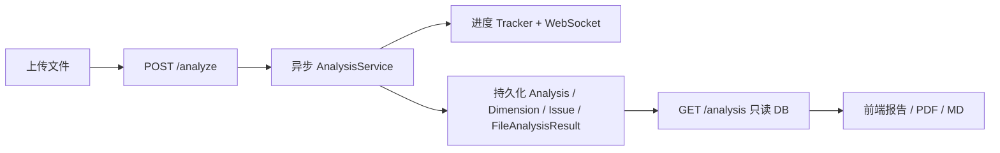

# Code-Diagnostician

代码质量静态分析工具：上传源码 → 多维度指标分析 → 可视化报告与导出。

## 技术栈

| 层 | 技术 |
|----|------|
| 前端 | Vue 3、Vite、Pinia、Ant Design Vue、ECharts |
| 后端 | Spring Boot 3.2、JPA、SQLite、WebSocket |
| 分析 | Eclipse JDT（Java AST）+ 多语言 GenericParser |

## 快速启动

### 一键启动（Windows）

```bat
run-all.cmd
```

- 后端：http://localhost:9999
- 前端：http://localhost:3000

### 分别启动

```bat
:: 后端
cd back-end
mvnw.cmd spring-boot:run

:: 前端
cd frontend
npm install
npm run dev
```

## 目录结构

```
Code-Diagnostician/
├── back-end/          # Spring Boot 后端
│   ├── src/main/java/.../controller/
│   ├── src/main/java/.../service/   # 异步分析、进度、WebSocket
│   └── uploads/                     # 上传文件（可配置 app.upload-dir）
├── frontend/          # Vue3 前端
├── 杂项/              # API 文档、todolist 等
└── run-all.cmd        # 一键启动脚本
```

## 数据流（简要）



## 配置要点

- 服务端口：`server.port=9999`（`back-end/src/main/resources/config/application.yml`）
- 上传目录：`app.upload-dir=uploads`（建议生产改为绝对路径）
- WebSocket：`ws://localhost:9999/ws/analysis/{projectId}`

## 文档

- API：`杂项/API-Documentation.md`
- 问题清单：`杂项/todolist.md`
