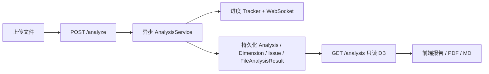
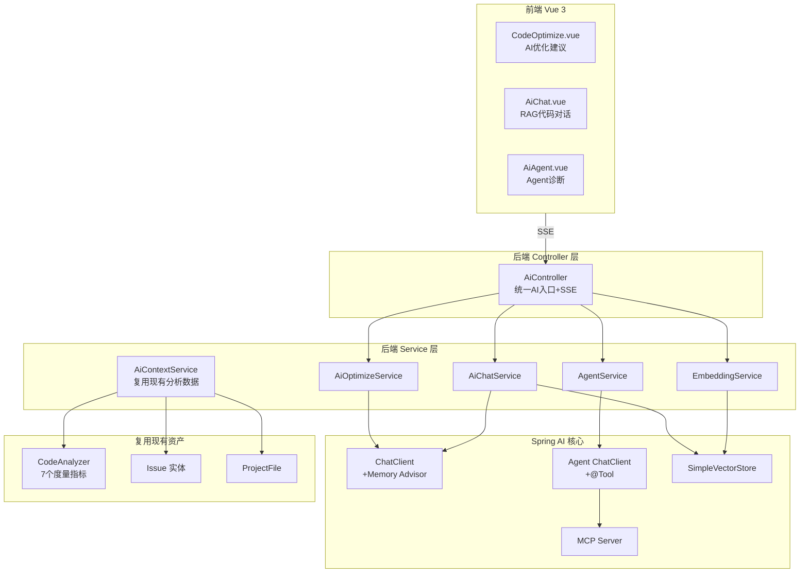
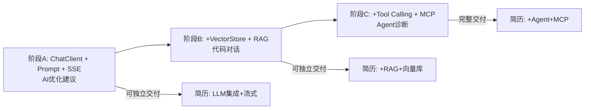

# Code-Diagnostician

代码质量静态分析工具：上传源码 → 多维度指标分析 → 可视化报告与导出。

## 技术栈

| 层 | 技术 |
|----|------|
| 前端 | Vue 3、Vite、Pinia、Ant Design Vue、ECharts |
| 后端 | Spring Boot 3.2、JPA、SQLite、WebSocket |
| 分析 | Eclipse JDT（Java AST）+ 多语言 GenericParser |

## 快速启动

### 一键启动（Windows）

```bat
run-all.cmd
```

- 后端：http://localhost:9999
- 前端：http://localhost:3000

### 分别启动

```bat
:: 后端
cd back-end
mvnw.cmd spring-boot:run

:: 前端
cd frontend
npm install
npm run dev
```

## 目录结构

```
Code-Diagnostician/
├── back-end/          # Spring Boot 后端（根包 `com.diagnostician`）
│   ├── src/main/java/com/diagnostician/
│   └── uploads/                     # 上传文件（可配置 app.upload-dir）
├── frontend/          # Vue3 前端
├── 杂项/              # API 文档、todolist 等
└── run-all.cmd        # 一键启动脚本
```

## 数据流（简要）



## 配置要点

- 服务端口：`server.port=9999`（`back-end/src/main/resources/config/application.yml`）
- 上传目录：`app.upload-dir=uploads`（建议生产改为绝对路径）
- WebSocket：`ws://localhost:9999/ws/analysis/{projectId}`

## 文档

- API：`杂项/API-Documentation.md`
- 问题清单：`杂项/todolist.md`


# AI功能：
## 一、技术栈选型

### 后端 AI 技术栈

| 层级 | 技术 | 版本 | 用途 |
|------|------|------|------|
| AI 框架 | **Spring AI** | 1.0.0 GA | Java 生态官方 LLM 集成框架，与 Spring Boot 无缝融合 |
| Spring Boot | 升级到 | 3.4.4 | 原 3.2.2 不兼容 Spring AI 1.0，升级到官方支持的 3.4.x |
| LLM 接入 | **多模型可切换** | - | DeepSeek / 通义千问 / OpenAI / Ollama，全部走 OpenAI 兼容协议 |
| 向量存储 | **SimpleVectorStore** | - | 内存级向量库，适合演示与中小项目 |
| 流式传输 | **SSE (SseEmitter)** | - | 单向流式生成，比 WebSocket 轻量 |
| 对话记忆 | **MessageWindowChatMemory** | - | Spring AI 内置窗口式记忆，30 条消息上限 |
| Agent 编排 | **@Tool + ChatClient** | - | Spring AI 原生工具调用机制 |
| MCP 协议 | **spring-ai-starter-mcp-server-webmvc** | - | 把分析能力协议化，可被 Cursor / Claude Code 复用 |
| 可观测性 | **Actuator + Micrometer** | - | 暴露 `/actuator/metrics`，监控 AI 请求总量 |

核心依赖在 [pom.xml](back-end/pom.xml) 第 148-178 行：

```148:178:back-end/pom.xml
        <!-- Spring AI：多模型 Chat + Embedding -->
        <dependency>
            <groupId>org.springframework.ai</groupId>
            <artifactId>spring-ai-starter-model-openai</artifactId>
        </dependency>
        <dependency>
            <groupId>org.springframework.ai</groupId>
            <artifactId>spring-ai-starter-model-ollama</artifactId>
        </dependency>

        <!-- Spring AI：向量存储 + RAG Advisor -->
        <dependency>
            <groupId>org.springframework.ai</groupId>
            <artifactId>spring-ai-vector-store</artifactId>
        </dependency>
        <dependency>
            <groupId>org.springframework.ai</groupId>
            <artifactId>spring-ai-advisors-vector-store</artifactId>
        </dependency>

        <!-- Spring AI：MCP Server（将分析能力协议化） -->
        <dependency>
            <groupId>org.springframework.ai</groupId>
            <artifactId>spring-ai-starter-mcp-server-webmvc</artifactId>
        </dependency>

        <!-- 可观测性：token / 延迟监控 -->
        <dependency>
            <groupId>org.springframework.boot</groupId>
            <artifactId>spring-boot-starter-actuator</artifactId>
        </dependency>
```

### 前端 AI 技术栈

| 技术 | 用途 |
|------|------|
| **Fetch + ReadableStream** | 消费 SSE 流，比 EventSource 更灵活（支持 POST 请求体） |
| **Pinia** | `stores/ai.js` 管理 AI 状态、流式内容、对话历史 |
| **Monaco Editor** | 代码对比展示（原始 vs AI 修复） |
| **Ant Design Vue** | 对话气泡、时间线、卡片等 AI 交互组件 |

### 模型切换机制

通过环境变量一键切换，无需改代码，见 [application.yml](back-end/src/main/resources/config/application.yml) 第 34-55 行。配置一个 `AI_PROVIDER=ollama` 就从云端 DeepSeek 切到本地 Llama，这正是 JD 里"多模型适配"的实操。

## 二、项目架构设计

### 整体分层架构



### 关键设计决策

**1. 复用而非重写**：AI 功能没有另起炉灶，而是通过 [AiContextService](back-end/src/main/java/com/diagnostician/service/ai/AiContextService.java) 桥接已有的 `CodeAnalyzer`、`Issue`、`ProjectFile`。静态分析产出的数据直接喂给 LLM，避免了重复计算。

**2. 双 ChatClient 设计**：普通对话和 Agent 用两个独立的 ChatClient，配置见 [AiConfig.java](back-end/src/main/java/com/diagnostician/config/AiConfig.java) 和 [AgentConfig.java](back-end/src/main/java/com/diagnostician/config/AgentConfig.java)。Agent 的 ChatClient 额外绑定 System Prompt 和 `@Tool`，普通对话只挂 Memory Advisor，职责分离。

**3. 流式统一封装**：[AiController](back-end/src/main/java/com/diagnostician/controller/AiController.java) 第 136-153 行的 `streamResponse` 方法把 Spring AI 的 `Flux<String>` 统一转成 `SseEmitter`，所有 AI 接口复用同一套流式管道：

```136:153:back-end/src/main/java/com/diagnostician/controller/AiController.java
    private SseEmitter streamResponse(reactor.core.publisher.Flux<String> flux) {
        ensureAiEnabled();
        aiRequestCounter.incrementAndGet();
        SseEmitter emitter = new SseEmitter(300_000L);
        flux.publishOn(Schedulers.boundedElastic())
                .subscribe(
                        token -> {
                            try {
                                emitter.send(SseEmitter.event().data(token));
                            } catch (IOException e) {
                                emitter.completeWithError(e);
                            }
                        },
                        emitter::completeWithError,
                        emitter::complete
                );
        return emitter;
    }
```

**4. 向量化与静态分析联动**：在 [AnalysisService](back-end/src/main/java/com/diagnostician/service/AnalysisService.java) 的 `analysis_completed` 事件后自动触发 `embeddingService.indexProject()`，用户无感知地完成代码向量化，RAG 对话时已有索引可用。

## 三、完成的功能清单

### 功能 1：AI 智能优化建议（方案 A 核心）

**入口**：`POST /api/projects/{id}/ai/summary/stream`、`/optimize/stream`、`/fix/stream`

**实现**：[AiOptimizeService](back-end/src/main/java/com/diagnostician/service/ai/AiOptimizeService.java) 提供四个能力：

- **质量摘要**：读取分析快照，LLM 生成 200-400 字诊断摘要 + 优先级建议
- **单 Issue 优化**：定位到具体 Issue 后，读取该文件源码上下文（前后 12 行），LLM 输出成因分析 + 重构步骤 + 代码示例 + 预期收益
- **批量优化报告**：按严重度排序取前 20 个 Issue，生成 P0/P1/P2 修复清单
- **修复代码生成**：读取更大代码窗口（前后 20 行），让 LLM 只输出修复后的代码片段

前端 [CodeOptimize.vue](frontend/src/views/CodeOptimize.vue) 把 Issue 列表和 AI 建议并排展示，点击"生成修复"后用 Monaco Editor 左右对比原始代码与 AI 修复建议。

### 功能 2：RAG 代码对话（方案 B 标准）

**入口**：`POST /api/projects/{id}/ai/chat/stream` + 对话管理接口

**实现链路**：

1. **代码向量化**：[EmbeddingService](back-end/src/main/java/com/diagnostician/service/ai/EmbeddingService.java) 用 [CodeDocumentSplitter](back-end/src/main/java/com/diagnostician/service/ai/CodeDocumentSplitter.java) 按函数边界切分代码（而非通用 Token 切分），每个 chunk 带 `projectId/filename/chunkIndex` 元数据写入向量库
2. **语义检索**：[AiChatService](back-end/src/main/java/com/diagnostician/service/ai/AiChatService.java) 第 82-89 行用 `SearchRequest` 做 topK=5、相似度阈值 0.45 的检索，并用 `filterExpression` 按项目隔离
3. **检索增强生成**：把检索到的代码片段拼进 Prompt，LLM 回答时标注引用文件
4. **对话持久化**：新建 `AiConversation` + `AiMessage` 两张表，多轮对话历史存 SQLite

前端 [AiChat.vue](frontend/src/views/AiChat.vue) 是完整的对话界面：左侧对话列表、右侧消息流、流式打字光标效果、回车发送。

### 功能 3：AI Agent 自动诊断（方案 C 完整）

**入口**：`POST /api/projects/{id}/ai/agent/stream`

**实现**：这是整个 AI 模块的技术高点。把静态分析能力封装成 5 个 `@Tool` 方法，见 [CodeAnalysisTools.java](back-end/src/main/java/com/diagnostician/service/ai/tools/CodeAnalysisTools.java)：

```25:36:back-end/src/main/java/com/diagnostician/service/ai/tools/CodeAnalysisTools.java
    @Tool(description = "列出项目中的所有源码文件")
    public String listProjectFiles(
            @ToolParam(description = "项目ID") String projectId
    ) {
        List<ProjectFile> files = contextService.listFiles(projectId);
        if (files.isEmpty()) {
            return "项目暂无文件";
        }
        return files.stream()
                .map(f -> "- " + f.getFilename() + " (" + f.getFileSize() + " bytes)")
                .collect(Collectors.joining("\n"));
    }
```

5 个工具分别是：`listProjectFiles`、`readProjectFile`、`getAnalysisSummary`、`analyzeProjectFile`（实时调 CodeAnalyzer）、`listTopIssues`。

[AgentConfig](back-end/src/main/java/com/diagnostician/config/AgentConfig.java) 给 Agent ChatClient 注入 System Prompt 和这组工具，[AgentService](back-end/src/main/java/com/diagnostician/service/ai/AgentService.java) 只需一句话触发，Spring AI 的 ChatClient 自动处理"LLM 决定调哪个工具 → 执行工具 → 把结果喂回 LLM → 继续推理"的 ReAct 循环。

前端 [AiAgent.vue](frontend/src/views/AiAgent.vue) 用 Ant Design 时间线展示工具调用轨迹，让 Agent 的推理过程可视化。

### 功能 4：MCP 协议化（差异化亮点）

**实现**：[McpServerConfig](back-end/src/main/java/com/diagnostician/config/McpServerConfig.java) 把同一组 `CodeAnalysisTools` 注册为 MCP Server 工具：

```15:20:back-end/src/main/java/com/diagnostician/config/McpServerConfig.java
    @Bean
    public ToolCallbackProvider mcpToolCallbackProvider(CodeAnalysisTools codeAnalysisTools) {
        return MethodToolCallbackProvider.builder()
                .toolObjects(codeAnalysisTools)
                .build();
    }
```

配置在 [application.yml](back-end/src/main/resources/config/application.yml) 第 59-64 行开启 MCP Server。这意味着同一套分析工具既能被本项目 Agent 调用，也能被 Cursor、Claude Code 等外部 IDE Agent 通过 MCP 协议发现和调用——这是 2026 年增速最快的单一技能。

### 功能 5：可观测性

[ObservabilityConfig](back-end/src/main/java/com/diagnostician/config/ObservabilityConfig.java) 注册了 `ai.requests.total` 指标，[AiController](back-end/src/main/java/com/diagnostician/controller/AiController.java) 每次流式请求自增计数器，`/actuator/metrics` 和 `/api/ai/status` 都能查到 AI 调用总量。

## 四、开发思路：递进式三层叠加

我没有一次性写完所有功能，而是按 A → B → C 三层递进，每层都是可独立交付的完整功能：



**这种设计的好处**：即使时间紧迫停在任意阶段，都能产出对应的简历亮点；技术栈层层叠加，学习曲线平滑。

## 五、启动与验证状态

- **后端编译**：`mvn compile` 通过（3 个既有单元测试失败是原项目遗留问题，与 AI 改动无关）
- **前端**：3 个 AI 页面 + 路由 + API 层 + Pinia store 已就绪
- **启动前**：参考 [back-end/.env.example](back-end/.env.example) 配置环境变量（至少需要 `OPENAI_API_KEY`）

启动后的完整用户流程：**上传代码 → 静态分析 → 报告页 → AI 优化建议 / AI 代码对话 / AI Agent 诊断**，三个 AI 入口都已恢复到 Report.vue 的"快速操作"区。

## 六、对标 JD 的技能覆盖

| JD 高频要求 | 本项目对应实现 |
|-------------|----------------|
| LLM 应用集成 | Spring AI ChatClient |
| Prompt Engineering | 4 套差异化提示词模板 |
| 流式输出 | SSE + Flux + ReadableStream |
| 多模型适配 | DeepSeek/Qwen/OpenAI/Ollama 环境变量切换 |
| RAG 检索增强 | 向量库 + 语义检索 + 元数据过滤 |
| 向量数据库 | SimpleVectorStore + 代码分块策略 |
| 对话记忆 | MessageWindowChatMemory + DB 持久化 |
| Tool/Function Calling | 5 个 @Tool 方法 + Agent 编排 |
| MCP 协议 | MCP Server 暴露分析能力 |
| 可观测性 | Actuator + Micrometer |
