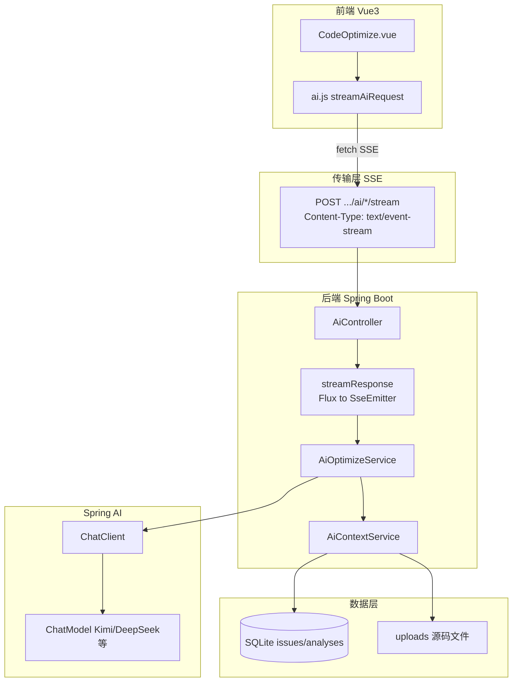
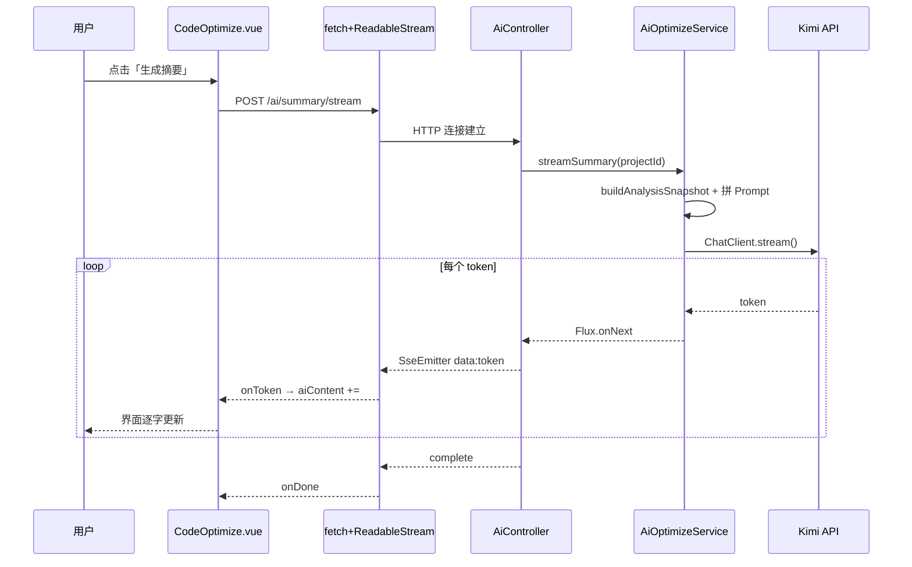

# AI 优化建议模块（方案 A）代码解析与学习文档

> 本文档面向面试准备与深度学习，完整解析 Code-Diagnostician 项目中 **AI 优化建议** 模块的设计思路、技术栈与逐层代码实现。
>
> 涉及文件：
> - 后端：[AiController.java](../back-end/src/main/java/com/diagnostician/controller/AiController.java)、[AiOptimizeService.java](../back-end/src/main/java/com/diagnostician/service/ai/AiOptimizeService.java)、[AiContextService.java](../back-end/src/main/java/com/diagnostician/service/ai/AiContextService.java)、[AiConfig.java](../back-end/src/main/java/com/diagnostician/config/AiConfig.java)
> - 前端：[CodeOptimize.vue](../frontend/src/views/CodeOptimize.vue)、[ai.js](../frontend/src/api/ai.js)

---

## 第一章：模块概述与架构设计

### 1.1 模块定位

**AI 优化建议** 是方案 A 的核心功能，解决一个具体问题：

> 静态分析引擎已经能发现代码问题（Issue），但给出的 `suggestion` 只是规则模板（如「优化%s相关代码」）。用户需要的是 **可执行、可理解、带代码示例** 的 LLM 优化方案。

本模块的职责：**把已有的静态分析结果 + 源码上下文，通过 Prompt Engineering 喂给大模型，流式生成优化建议。**

它不重新跑分析，而是 **复用** 以下已有资产：

| 已有资产 | 来源 | 在 AI 模块中的用途 |
|----------|------|-------------------|
| `Issue` 列表 | 7 个 Metric 分析后入库 | 优化建议的输入 |
| `Analysis` + `Dimension` | 分析结果聚合 | 生成摘要的数据源 |
| 项目源码文件 | `uploads/{projectId}/` | 提取问题行附近的代码上下文 |
| `GET /api/projects/{id}/analysis` | 已有 REST 接口 | 前端加载 Issue 列表 |

### 1.2 三大功能

进入 `/project/:id/optimize` 页面后，用户可执行三个操作：

| 功能 | 按钮位置 | 后端方法 | 输入 | 输出 |
|------|----------|----------|------|------|
| **生成摘要** | 左栏卡片右上角 | `streamSummary` | 全项目分析快照 | 200-400 字质量诊断摘要 |
| **优化建议** | 右栏「优化建议」按钮 | `streamOptimize` | 单个 Issue + 源码上下文 | 成因分析 + 重构步骤 + 代码示例 |
| **生成修复** | 右栏「生成修复」按钮 | `streamFixCode` | 单个 Issue + 更大源码窗口 | 修复后代码片段 + Monaco 对比 |

额外存在但未暴露为独立按钮的能力：`streamBatchOptimize`（无 `issueId` 时批量优化报告），由 `optimize/stream` 接口在无 `issueId` 时触发。

### 1.3 整体架构



### 1.4 核心设计决策

1. **不重复分析，只增强建议**  
   LLM 不负责「发现问题」，只负责「解释问题 + 给出修复方案」。分析可信度由静态引擎保证，AI 负责可读性与可执行性。

2. **SSE 流式输出，而非一次性 JSON**  
   LLM 生成较慢，流式让用户看到「打字机效果」，体验接近 ChatGPT。且 AI 优化页是 **单向推送**，SSE 比 WebSocket 更轻量。

3. **Prompt 按场景分模板，而非一套 Prompt 打天下**  
   摘要、单 Issue 优化、批量报告、代码修复，上下文结构和输出格式不同，对应 4 套 Prompt。

4. **源码上下文按行号窗口截取**  
   不把整个文件塞进 Prompt（浪费 token、易超上下文），只取问题行前后 N 行（优化 12 行、修复 20 行）。

5. **文件读取失败可降级**  
   `streamOptimize` / `streamFixCode` 对 `readFileContent` 做 try-catch，读不到源码时仍让 LLM 基于 `message` + `suggestion` 给建议。

---

## 第二章：技术栈解析

### 2.1 技术栈总览

| 层级 | 技术 | 版本/说明 | 在本模块中的作用 |
|------|------|-----------|------------------|
| AI 框架 | **Spring AI** | 1.0.0 | `ChatClient`、`ChatModel`、OpenAI 兼容协议 |
| 后端框架 | **Spring Boot** | 3.4.4 | REST、依赖注入、配置绑定 |
| 流式响应 | **SseEmitter** | Spring MVC | HTTP SSE 推送到浏览器 |
| 响应式流 | **Reactor Flux** | Spring AI 返回类型 | `chatClient.stream().content()` |
| 配置加载 | **spring-dotenv** | 5.1.0 | 从 `back-end/.env` 读 API Key |
| 前端框架 | **Vue 3** | Composition API | 页面状态与交互 |
| UI | **Ant Design Vue** | 4.x | 卡片、按钮、Spin、Alert |
| 代码展示 | **Monaco Editor** | 0.44 | 修复前后代码对比 |
| 流式消费 | **Fetch API + ReadableStream** | 浏览器原生 | 解析 SSE，非 EventSource（因需 POST） |

### 2.2 Spring AI ChatClient

Spring AI 是 Spring 官方推出的 LLM 集成框架，对标 Python 生态的 LangChain，但更符合 Spring 开发习惯。

本模块使用的核心 API 链：

```java
chatClient.prompt()           // 构建请求
    .user(prompt)             // 设置用户消息（我们的 Prompt 模板）
    .stream()                 // 流式模式
    .content();               // 返回 Flux<String>，每个元素是一个 token 片段
```

**为什么选 Spring AI 而不是 LangChain4j？**（面试常问）

- 项目已是 Spring Boot，Spring AI 与 `@Configuration`、`application.yml`、Actuator 无缝集成
- `ChatClient` + Advisor 模式类似 Spring 里熟悉的 `RestTemplate` / `WebClient`
- 多模型通过 OpenAI 兼容协议切换 base-url 即可（Kimi、DeepSeek、OpenAI）

### 2.3 SSE（Server-Sent Events）

- **协议**：基于 HTTP，服务端持续向客户端推送 `text/event-stream`
- **与 WebSocket 对比**：

| 维度 | SSE | WebSocket |
|------|-----|-----------|
| 方向 | 单向（服→客） | 双向 |
| 协议 | 普通 HTTP | 独立 ws:// 协议 |
| 实现复杂度 | 低（SseEmitter） | 需 Handler + 心跳 |
| 适用场景 | LLM 流式生成、日志推送 | 聊天双向、游戏 |

本项目 **分析进度** 用 WebSocket（`AnalysisWebSocketHub`），**AI 生成** 用 SSE，职责分离。

### 2.4 多模型适配

通过 OpenAI 兼容 API 统一接入：

```yaml
# back-end/.env 示例（当前项目：Kimi）
AI_PROVIDER=kimi
OPENAI_API_KEY=sk-xxx
OPENAI_BASE_URL=https://api.moonshot.cn    # 注意：不要带 /v1，Spring AI 会自动拼接
OPENAI_CHAT_MODEL=moonshot-v1-8k
```

`AiConfig` 中 `@Primary ChatModel` 根据 `AI_PROVIDER` 在 OpenAI 兼容实现与 Ollama 之间切换。

---

## 第三章：后端代码逐层解析

### 3.1 入口层：AiController

文件：`back-end/src/main/java/com/diagnostician/controller/AiController.java`

#### 3.1.1 三个 SSE 端点

```java
// 生成摘要 — 不需要请求体
@PostMapping(value = "/projects/{id}/ai/summary/stream", produces = MediaType.TEXT_EVENT_STREAM_VALUE)
public SseEmitter streamSummary(@PathVariable String id) {
    return streamResponse(optimizeService.streamSummary(id));
}

// 优化建议 — issueId 可选；有则单 Issue，无则批量
@PostMapping(value = "/projects/{id}/ai/optimize/stream", produces = MediaType.TEXT_EVENT_STREAM_VALUE)
public SseEmitter streamOptimize(@PathVariable String id, @RequestBody(required = false) Map<String, String> body) {
    String issueId = body != null ? body.get("issueId") : null;
    if (issueId != null && !issueId.isBlank()) {
        return streamResponse(optimizeService.streamOptimize(id, issueId));
    }
    return streamResponse(optimizeService.streamBatchOptimize(id));
}

// 生成修复 — issueId 必填
@PostMapping(value = "/projects/{id}/ai/fix/stream", produces = MediaType.TEXT_EVENT_STREAM_VALUE)
public SseEmitter streamFix(...) { ... }
```

**设计要点**：

- `produces = TEXT_EVENT_STREAM_VALUE` 告诉 Spring 响应类型为 `text/event-stream`
- 立即返回 `SseEmitter`，HTTP 连接保持打开，后续 token 持续写入
- `streamResponse` 统一处理所有 AI 流式接口，避免重复订阅逻辑

#### 3.1.2 核心管道：streamResponse

```java
private SseEmitter streamResponse(Flux<String> flux) {
    ensureAiEnabled();
    aiRequestCounter.incrementAndGet();
    SseEmitter emitter = new SseEmitter(300_000L);  // 超时 5 分钟

    flux.publishOn(Schedulers.boundedElastic())     // 在弹性线程池执行，不阻塞 Tomcat 线程
        .subscribe(
            token -> {
                emitter.send(SseEmitter.event().data(token));  // 每个 token 一个 SSE data 事件
            },
            error -> {
                // 错误时先发 event:error，再 completeWithError
                emitter.send(SseEmitter.event().name("error").data("[AI_ERROR] " + errMsg));
                emitter.completeWithError(error);
            },
            emitter::complete
        );
    return emitter;
}
```

**数据流**：

```
LLM API → Spring AI ChatClient → Flux<String>
    → subscribe 每个 token → SseEmitter.send("data: {token}\n\n")
    → 浏览器 ReadableStream 逐段读取
```

**为什么用 `publishOn(Schedulers.boundedElastic())`？**  
Reactor 的阻塞式 HTTP 调用若在 Tomcat 请求线程上执行，会占满线程池；放到 boundedElastic 可避免阻塞容器线程。

---

### 3.2 核心业务层：AiOptimizeService

文件：`back-end/src/main/java/com/diagnostician/service/ai/AiOptimizeService.java`

依赖：

```java
private final ChatClient chatClient;        // Spring AI 对话客户端
private final AiContextService contextService;  // 读 DB、读文件、拼快照
private final AiProperties aiProperties;    // maxContextIssues 等配置
```

#### 3.2.1 streamSummary — 生成摘要

```java
public Flux<String> streamSummary(String projectId) {
    Map<String, Object> snapshot = contextService.buildAnalysisSnapshot(projectId);
    String prompt = """
        你是资深代码审查专家。请根据以下静态分析结果，用中文生成一份简洁的质量诊断摘要（200-400字）：
        - 总体评分与等级
        - 主要风险维度（按优先级）
        - 3-5 条可执行的修复建议

        分析数据：
        %s
        """.formatted(snapshot);
    return chatClient.prompt().user(prompt).stream().content();
}
```

**流程**：

1. `buildAnalysisSnapshot` 从 DB 组装：`projectName`、`overallScore`、`grade`、`dimensions`、`topIssues`（前 10 条）
2. `Map.toString()` 序列化进 Prompt（简单但有效；生产可改为 JSON）
3. 无源码读取，token 消耗最小
4. 直接 `stream().content()` 返回 Flux

**面试表述**：摘要功能是典型的 **「结构化数据 + 角色 Prompt」**，不需要 RAG，也不需要对话记忆。

#### 3.2.2 streamOptimize — 单 Issue 优化建议

```java
public Flux<String> streamOptimize(String projectId, String issueId) {
    Analysis analysis = contextService.requireLatestAnalysis(projectId);
    List<Issue> issues = contextService.getIssuesForAnalysis(analysis.getId());
    Issue target = issues.stream()
        .filter(i -> issueId == null || issueId.isBlank() || issueId.equals(i.getId()))
        .findFirst()
        .orElseThrow(() -> new ResourceNotFoundException("未找到对应问题"));

    String codeContext = "";
    try {
        String content = contextService.readFileContent(projectId, target.getFile());
        codeContext = contextService.extractCodeContext(content, target.getLine() != null ? target.getLine() : 1, 12);
    } catch (Exception ignored) {
        codeContext = "（无法读取源码上下文）";
    }

    String prompt = """ ... Issue 各字段 + codeContext ... """.formatted(...);
    return chatClient.prompt().user(prompt).stream().content();
}
```

**关键点**：

- 用 `issueId` 精确定位一条 `Issue`
- **源码窗口半径 12 行**：在 token 成本与上下文充分性之间折中
- **try-catch 降级**：路径解析失败不导致 500，仍可向 LLM 要文字建议

#### 3.2.3 streamBatchOptimize — 批量优化（隐藏能力）

当 `optimize/stream` 未传 `issueId` 时调用：

```java
List<Issue> issues = ...stream()
    .sorted(Comparator.comparingInt(i -> severityRank(i.getSeverity())))
    .limit(aiProperties.getMaxContextIssues())  // 默认 20
    .collect(Collectors.toList());
```

按 `high → medium → low` 排序后取前 20 条，避免 Prompt 过长。要求 LLM 输出 P0/P1/P2 结构化 Markdown 报告。

#### 3.2.4 streamFixCode — 生成修复代码

与 `streamOptimize` 类似，但：

- **必须** 有 `issueId`
- 源码窗口 **20 行**（比优化建议更大，便于生成完整修复片段）
- Prompt 强调：**只输出 Markdown 代码块 + 一行修改说明**，便于前端用正则提取代码做 diff

```java
String prompt = """
    你是代码修复助手。请只输出修复后的代码片段（Markdown 代码块），并附一行修改说明。
    ...
    """;
```

---

### 3.3 数据桥接层：AiContextService

文件：`back-end/src/main/java/com/diagnostician/service/ai/AiContextService.java`

这是 AI 模块与 **现有业务数据** 的桥梁，避免在 `AiOptimizeService` 里写 SQL/读文件。

#### 3.3.1 buildAnalysisSnapshot

```java
public Map<String, Object> buildAnalysisSnapshot(String projectId) {
    Project project = requireProject(projectId);
    Analysis analysis = requireLatestAnalysis(projectId);
    List<Issue> issues = getIssuesForAnalysis(analysis.getId());

    Map<String, Object> snapshot = new LinkedHashMap<>();
    snapshot.put("projectName", project.getName());
    snapshot.put("overallScore", analysis.getOverallScore());
    snapshot.put("grade", analysis.getGrade());
    snapshot.put("issueCount", issues.size());
    snapshot.put("dimensions", analysis.getDimensions().stream().map(d -> Map.of(
        "name", d.getName(), "score", d.getScore(), "issues", d.getIssues()
    )).toList());
    snapshot.put("topIssues", issues.stream().limit(10).map(this::issueToMap).toList());
    return snapshot;
}
```

**设计意图**：把 JPA 实体转成 LLM 友好的扁平结构，且只取 top 10 issues，控制 Prompt 长度。

#### 3.3.2 resolveProjectFilePath — 三级回退

Issue 里存的 `file` 可能是：

- 用户友好名 `Foo.java`
- 数据库存的 `filePath`
- 带 UUID 前缀的物理名 `a1b2_Foo.java`

```java
private Path resolveProjectFilePath(String projectId, String path) {
    // 1. 精确匹配 filename 或 filePath
    for (ProjectFile pf : files) {
        if (path.equals(pf.getFilename()) || path.equals(pf.getFilePath())) {
            return Paths.get(pf.getFilePath());
        }
    }
    // 2. 仅比较文件名部分（去掉路径前缀）
    String pathFileName = Paths.get(path).getFileName().toString();
    for (ProjectFile pf : files) {
        if (pathFileName.equals(Paths.get(pf.getFilePath()).getFileName().toString())) {
            return Paths.get(pf.getFilePath());
        }
    }
    // 3. 回退到 uploads/{projectId}/{path}
    Path byName = Paths.get(appProperties.getUploadDir(), projectId, path);
    if (Files.exists(byName)) return byName;
    return null;
}
```

这是 **「生成修复」曾失败的重要原因之一**：路径不一致时读文件抛异常；已在 `streamFixCode` 中增加降级处理。

#### 3.3.3 extractCodeContext — 代码窗口

```java
public String extractCodeContext(String content, int line, int radius) {
    String[] lines = content.split("\n", -1);
    int idx = Math.max(0, Math.min(lines.length - 1, line - 1));  // line 是 1-based
    int start = Math.max(0, idx - radius);
    int end = Math.min(lines.length, idx + radius + 1);
    // 输出格式：行号| 代码，便于 LLM 对齐
    sb.append(String.format("%4d| %s%n", i + 1, lines[i]));
}
```

输出示例：

```
  38|     public void badMethod() {
  39|         if (a) { if (b) { if (c) { ... } } }
  40|     }
```

---

### 3.4 配置层：AiConfig

文件：`back-end/src/main/java/com/diagnostician/config/AiConfig.java`

```java
@Bean
public ChatClient chatClient(ChatClient.Builder builder, MessageWindowChatMemory chatMemory) {
    return builder
        .defaultAdvisors(MessageChatMemoryAdvisor.builder(chatMemory).build())
        .build();
}
```

- `SimpleLoggerAdvisor`：在 Builder 上记录请求日志（调试用）
- `MessageChatMemoryAdvisor`：为 **对话类** 功能（AiChat）准备；本优化页每次请求是 **无状态单轮 Prompt**，不依赖历史消息
- `maxMessages(30)`：内存中保留最近 30 条消息（对话模块用）

`AiOptimizeService` 注入的是这个 `ChatClient` Bean，所有优化/摘要/修复共用同一模型配置。

---

## 第四章：前端代码逐层解析

### 4.1 页面结构：CodeOptimize.vue

路由：`/project/:id/optimize`  
文件：`frontend/src/views/CodeOptimize.vue`

#### 4.1.1 布局

```
┌─────────────────────────────────────────────────────────┐
│  页面标题：AI 优化建议                                    │
├──────────────────┬──────────────────────────────────────┤
│ 左栏 10列         │ 右栏 14列                             │
│ 「分析问题」卡片   │ 「AI 建议」卡片                        │
│ - 生成摘要按钮     │ - 优化建议 / 生成修复 按钮             │
│ - Issue 列表可点击 │ - 流式 Markdown 展示区                 │
│                  │ - （可选）代码对比 Monaco 双栏           │
└──────────────────┴──────────────────────────────────────┘
```

#### 4.1.2 状态变量

```javascript
const issues = ref([])              // 从 GET /analysis 加载
const selectedIssue = ref(null)     // 用户点击选中的 Issue
const aiContent = ref('')          // 累积的 LLM 流式输出全文
const summaryLoading / optimizeLoading / fixLoading  // 三个按钮 loading
const showDiff = ref(false)         // 是否展示代码对比区
const originalCode / fixedCode      // Monaco 左右栏内容
```

#### 4.1.3 页面加载

```javascript
onMounted(async () => {
  await checkAiStatus()   // GET /api/ai/status，展示配置提示
  await loadIssues()      // GET /api/projects/{id}/analysis → issues
})
```

#### 4.1.4 流式调用的 Promise 包装模式

三个功能共用同一模式：

```javascript
async function generateSummary() {
  summaryLoading.value = true
  aiContent.value = ''
  try {
    await new Promise((resolve, reject) => {
      aiApi.streamSummary(projectId.value, {
        onToken: (t) => { aiContent.value += t },  // 每收到 token 追加
        onDone: resolve,
        onError: reject
      })
    })
  } catch (e) {
    message.error('生成摘要失败: ' + (e.message || '请检查 AI 配置'))
  } finally {
    summaryLoading.value = false
  }
}
```

**为什么用 Promise 包一层？**  
`streamAiRequest` 是回调风格（onToken/onDone/onError），用 Promise 可以配合 `async/await` 和 `loading` 状态，代码更清晰。

#### 4.1.5 生成修复 + 代码对比

```javascript
async function generateFix() {
  // ... 流式生成 aiContent ...
  await loadCodeForDiff()
}

async function loadCodeForDiff() {
  const res = await uploadApi.getFileContent(projectId.value, selectedIssue.value.file)
  originalCode.value = res?.data?.content || ''
  const match = aiContent.value.match(/```[\w]*\n([\s\S]*?)```/)
  fixedCode.value = match ? match[1] : aiContent.value
  showDiff.value = true
}
```

- 用正则从 LLM 回复中提取 **第一个 Markdown 代码块** 作为「修复后代码」
- 左侧 Monaco 显示原始文件，右侧显示 AI 修复建议（只读）

#### 4.1.6 简易 Markdown 渲染

```javascript
const renderedContent = computed(() => {
  return aiContent.value
    .replace(/```(\w*)\n([\s\S]*?)```/g, '<pre><code>$2</code></pre>')
    .replace(/\n/g, '<br>')
})
```

生产环境可替换为 `marked` 等库；当前实现足够展示流式文本与代码块。

---

### 4.2 API 层：ai.js

文件：`frontend/src/api/ai.js`

#### 4.2.1 为什么不用 EventSource？

标准 `EventSource` **只支持 GET**，而本模块需要 **POST**（传 `issueId` 等 body）。因此使用：

```javascript
fetch(url, {
  method: 'POST',
  headers: { Accept: 'text/event-stream' },
  body: JSON.stringify(body)
})
```

#### 4.2.2 SSE 解析逻辑（核心）

```javascript
const reader = response.body.getReader()
const decoder = new TextDecoder()
let buffer = ''

while (true) {
  const { done, value } = await reader.read()
  if (done) break
  buffer += decoder.decode(value, { stream: true })

  const events = buffer.split('\n\n')   // SSE 事件以空行分隔
  buffer = events.pop() || ''

  for (const eventBlock of events) {
    // 解析 event: 和 data: 行
    if (line.startsWith('event:')) currentEvent = ...
    if (line.startsWith('data:')) dataBuffer += cleaned
    flushData()  // onToken 或 onError
  }
}
```

**注意**：多行 `data:` 要拼接；`event:error` 时走 `onError` 而非 `onToken`。

#### 4.2.3 暴露的 API

```javascript
export const aiApi = {
  streamSummary: (projectId, handlers) =>
    streamAiRequest(`/projects/${projectId}/ai/summary/stream`, null, ...),
  streamOptimize: (projectId, issueId, handlers) =>
    streamAiRequest(`/projects/${projectId}/ai/optimize/stream`, { issueId }, ...),
  streamFix: (projectId, issueId, handlers) =>
    streamAiRequest(`/projects/${projectId}/ai/fix/stream`, { issueId }, ...),
}
```

---

## 第五章：Prompt Engineering 设计

### 5.1 四套模板对比

| 方法 | 角色设定 | 注入上下文 | 输出要求 |
|------|----------|------------|----------|
| streamSummary | 资深代码审查专家 | 全项目 snapshot | 200-400 字，评分+风险+3-5 条建议 |
| streamOptimize | 代码质量优化专家 | 单 Issue 六字段 + 12 行代码 | 成因、步骤、代码示例、收益 |
| streamBatchOptimize | 代码质量顾问 | 最多 20 条 Issue 列表 | Markdown：P0/P1/P2 + 分维度 + 快速收益 |
| streamFixCode | 代码修复助手 | Issue + 20 行代码 | **仅** 代码块 + 一行说明 |

### 5.2 设计原则

1. **角色先行（Role Prompting）**  
   明确「你是谁」可稳定输出风格和专业度。

2. **结构化输入**  
   Issue 用 `- 类型: / - 严重度:` 列表，比 JSON 更易被模型阅读。

3. **约束输出格式**  
   「只输出代码块」减少废话，方便前端正则提取。

4. **控制 token**  
   - 摘要：不传源码  
   - 优化：12 行窗口  
   - 批量：最多 20 条 Issue  
   - 配置项：`app.ai.max-context-issues=20`、`max-code-chars=8000`

### 5.3 面试如何讲 Prompt

> 「我没有用一个通用 Prompt，而是按 **任务类型** 拆成四套模板。摘要任务只需要聚合指标；单点优化需要 **Issue 元数据 + 局部源码**；修复任务则要 **更强约束输出为可 diff 的代码块**。同时在 Service 层做 **上下文裁剪**，避免超上下文窗口。」

---

## 第六章：SSE 流式传输全链路

### 6.1 端到端时序



### 6.2 后端 SSE 帧格式

Spring `SseEmitter.event().data(token)` 大致产生：

```
data: 根据

data: 静态分析

data: 结果...
```

前端按 `\n\n` 切事件，再解析 `data:` 行。

### 6.3 错误传播

1. LLM 401/404 → Reactor `onError`
2. Controller 发送 `event: error` + `data: [AI_ERROR] ...`
3. 前端 `flushData` 识别 `currentEvent === 'error'` → `onError`
4. Vue `message.error('生成摘要失败: ...')`

### 6.4 与 WebSocket 分析进度的分工

| 场景 | 技术 | 文件 |
|------|------|------|
| 静态分析进度 | WebSocket `/ws/analysis/{id}` | AnalysisWebSocketHub |
| AI 文本生成 | SSE `/ai/*/stream` | AiController.streamResponse |

**面试一句话**：分析进度要双向心跳和阶段事件用 WebSocket；LLM 单向下行文本流用 SSE 更简单。

---

## 第七章：面试话术与高频问题

### 7.1 30 秒电梯演讲

> 「我在 Code-Diagnostician 里做了 **AI 优化建议** 模块：在静态分析产出 Issue 之后，用 **Spring AI ChatClient** 接 Kimi 等 OpenAI 兼容模型，通过 **四套 Prompt 模板** 分别做质量摘要、单点优化和代码修复；后端用 **SseEmitter** 把 `Flux<String>` 推成 SSE，前端用 **Fetch + ReadableStream** 做流式展示，并接 **Monaco** 做修复前后对比。核心是 **复用分析结果 + 源码行号窗口**，不重复造分析引擎。」

### 7.2 2 分钟详细版

1. **背景**：静态分析能找问题，但建议太模板化。  
2. **方案**：方案 A，LLM 增强建议，不接 RAG（本页）。  
3. **架构**：Vue → ai.js → AiController → AiOptimizeService → AiContextService → ChatClient。  
4. **亮点**：SSE 流式、Prompt 分场景、文件路径三级回退、读文件失败降级。  
5. **技术栈**：Spring AI 1.0、Spring Boot 3.4、Vue3、Monaco。  
6. **可扩展**：同一套 `streamResponse` 可复用到 Chat、Agent 模块。

### 7.3 高频面试 Q&A

**Q1：为什么用 Spring AI 而不是 LangChain4j？**

> 项目是 Spring Boot 技术栈，Spring AI 与配置、依赖注入、可观测性一致；ChatClient 流式 API 简洁。LangChain4j 更偏「积木式」组装，适合多框架或非 Spring 场景。我熟悉 Spring 生态，所以选 Spring AI。

**Q2：SSE 和 WebSocket 区别？为什么这里用 SSE？**

> SSE 是 HTTP 单向流，实现简单，适合 LLM 逐 token 下发；WebSocket 双向，适合分析进度、取消信号。本页只需要服务端推文本，所以 SSE 足够且更轻。

**Q3：Prompt 怎么设计的？**

> 按任务拆四套模板：摘要用全量指标；单点优化用 Issue 字段 + 12 行源码；修复用 20 行源码并约束只输出代码块。统一用中文角色设定，并在 Service 层限制 Issue 条数和代码字符数。

**Q4：LLM 返回的代码不对怎么办？**

> 当前是 **建议型** 产品，不自动改文件。前端仅只读对比；用户自行采纳。可改进：加「应用修复」二次确认、单元测试校验、或 Structured Output 约束 JSON 格式。

**Q5：前端流式怎么实现的？**

> POST + `Accept: text/event-stream`，`response.body.getReader()` 循环读 chunk，`TextDecoder` 解码，按 `\n\n` 拆 SSE 事件，解析 `data:` 行累积到 `aiContent`，实现打字机效果。

**Q6：多模型怎么切换？**

> `back-end/.env` 配置 `AI_PROVIDER`、`OPENAI_BASE_URL`、`OPENAI_CHAT_MODEL`；Spring AI 走 OpenAI 兼容协议。Kimi 的 base-url 是 `https://api.moonshot.cn`（不要带 `/v1`）。spring-dotenv 从项目 `.env` 加载，不污染系统环境变量。

**Q7：这个模块的亮点？**

> 第一，**与静态分析闭环**：不是空聊代码，而是 Issue 驱动的可执行建议。第二，**工程化流式链路**：Flux → SseEmitter → ReadableStream 全链路打通。第三，**Prompt 与上下文工程**：行号窗口、批量截断、降级策略。第四，**可面试延展**：同架构扩展到 RAG 对话、Agent Tool Calling。

**Q8：如果让你继续改进？**

> 1）Prompt 模板外置为 `.st` 文件或配置中心；2）`buildAnalysisSnapshot` 改为 JSON + Structured Output；3）修复建议加 diff-match-patch 高亮；4）对 LLM 调用加熔断、重试、token 计费监控；5）用户反馈「有用/无用」做 Prompt 迭代。

### 7.4 建议演示路径（面试现场）

1. 打开报告页 → 点「AI 优化建议」  
2. 展示 Issue 列表 → 选一条 → 点「优化建议」看流式输出  
3. 点「生成修复」展示 Monaco 对比  
4. 打开 IDE 指到 `AiOptimizeService.streamOptimize` 和 `AiController.streamResponse` 讲清调用链  

---

## 附录 A：关键 API 一览

| 方法 | 路径 | 说明 |
|------|------|------|
| POST | `/api/projects/{id}/ai/summary/stream` | 生成摘要（SSE） |
| POST | `/api/projects/{id}/ai/optimize/stream` | 优化建议（SSE），body: `{ issueId? }` |
| POST | `/api/projects/{id}/ai/fix/stream` | 生成修复（SSE），body: `{ issueId }` 必填 |
| GET | `/api/projects/{id}/analysis` | 前端加载 Issue 列表 |
| GET | `/api/projects/{id}/files/content?path=` | 读取源码做 diff |

---

## 附录 B：配置检查清单

| 检查项 | 配置位置 |
|--------|----------|
| Chat API Key | `back-end/.env` → `OPENAI_API_KEY` |
| Chat Base URL | `OPENAI_BASE_URL`（Kimi: `https://api.moonshot.cn`） |
| Chat 模型 | `OPENAI_CHAT_MODEL`（如 `moonshot-v1-8k`） |
| 启用 AI | `app.ai.enabled=true`（application.yml） |
| 需先完成静态分析 | 否则 Issue 列表为空 |

---

## 附录 C：学习路径建议

1. **第一遍**：读第一章 + 第七章，建立整体印象与面试话术。  
2. **第二遍**：对照第三章，在 IDE 里单步跟 `streamOptimize` 调用链。  
3. **第三遍**：读第五章 + 第六章，理解 Prompt 与 SSE，自己画一张时序图。  
4. **第四遍**：用附录演示路径在本地跑通三个按钮，并故意改错 base-url 观察错误传播。

---

*文档版本：与 Code-Diagnostician 代码库 2026-07 实现一致。*
