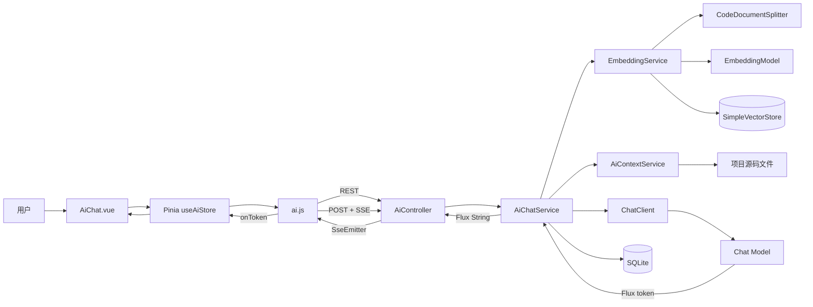
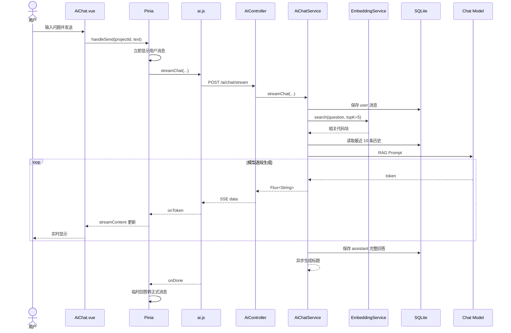

# AI 代码对话功能模块（方案 B）代码解析

> 本文用于系统学习 Code-Diagnostician 的方案 B：基于项目文件内容进行 AI 代码问答。
>
> 阅读目标：不仅会演示功能，还能解释它为什么这样设计、一次提问如何完整流转、RAG 如何建立与检索、会话如何持久化，以及当前实现有哪些边界。

---

## 第一阶段：先建立整体认识

### 1.1 方案 B 解决什么问题

方案 A 的 AI 优化建议以静态分析产生的 `Issue` 为入口，适合回答“这个已知问题如何修复”。

方案 B 进一步允许用户直接用自然语言询问整个项目，例如：

- “这个项目的核心调用链是什么？”
- “哪个类负责读取上传的源文件？”
- “为什么这个方法可能出现空指针？”
- “请解释 `AiController` 与 `AiChatService` 的职责边界。”
- “上一轮提到的索引逻辑还有哪些风险？”

普通大模型并不知道用户刚上传的私有代码。方案 B 因而采用 **RAG（Retrieval-Augmented Generation，检索增强生成）**：

1. 读取当前项目的源文件；
2. 把源代码切分成较小的代码块；
3. 用 Embedding 模型把代码块转成向量；
4. 把向量保存到本地向量库；
5. 用户提问时，把问题也转成向量；
6. 检索语义最相近的 5 个代码块；
7. 将代码块、最近对话历史和当前问题一起注入 Prompt；
8. Chat 模型基于这些上下文流式作答。

因此，本模块不是让模型“凭记忆猜代码”，而是先从当前项目中找到证据，再让模型组织答案。

### 1.2 这里的“根据文件内容对话”具体指什么

当前页面没有让用户手动勾选某个文件。实际策略是：

- 页面初始化时，对**当前项目的全部已上传文件**建立向量索引；
- 每次提问时，在全部索引中做语义检索；
- 再用 `projectId` 过滤，确保只使用当前项目的代码块；
- 选出最相关的前 5 个代码块作为本次上下文。

这是一种“项目级知识库问答”，而不是“单文件聊天”。

### 1.3 整体架构



### 1.4 一次提问的主调用链

```text
AiChat.vue.handleSend
  → useAiStore.handleSend
    → aiApi.streamChat
      → streamAiRequest(fetch + ReadableStream)
        → POST /api/projects/{projectId}/ai/chat/stream
          → AiController.streamChat
            → AiChatService.streamChat
              ├─ 校验会话归属
              ├─ 保存用户消息
              ├─ EmbeddingService.search 检索代码
              ├─ buildRecentHistory 拼最近历史
              ├─ 构造 RAG Prompt
              └─ ChatClient.stream().content()
            → AiController.streamResponse
              → Flux<String> 转 SseEmitter
        ← SSE token 持续返回
      ← onToken(token)
    ← streamContent += token
  ← Vue 实时渲染
```

---

## 第二阶段：技术栈与选型

### 2.1 技术栈总览

| 层次 | 技术 | 项目中的职责 |
|---|---|---|
| 后端基础 | Java 21、Spring Boot 3.4.4 | Web、依赖注入、配置管理 |
| AI 框架 | Spring AI 1.0.0 | ChatClient、EmbeddingModel、VectorStore |
| Chat 模型 | OpenAI 兼容模型或 Ollama | 根据上下文生成答案 |
| Embedding 模型 | OpenRouter / OpenAI / Ollama | 把问题和代码转成语义向量 |
| 向量存储 | Spring AI `SimpleVectorStore` | 本地相似度检索与 JSON 持久化 |
| 响应式流 | Reactor `Flux`、`Mono` | 接收 token 流和异步执行索引/标题任务 |
| 流式传输 | Spring MVC `SseEmitter` | 将 `Flux<String>` 转成浏览器可消费的 SSE |
| 业务持久化 | Spring Data JPA + SQLite | 保存对话和消息 |
| 前端 | Vue 3 + Composition API | 对话页面及交互 |
| 状态管理 | Pinia | 管理会话、消息和流式状态 |
| 网络 | Axios + Fetch + ReadableStream | 普通 CRUD 用 Axios，SSE POST 用 Fetch |
| 本地配置 | spring-dotenv | 从 `back-end/.env` 读取模型配置 |

### 2.2 为什么需要两个模型

RAG 通常包含两类模型：

1. **Embedding 模型**：把文本映射为向量，负责“找资料”；
2. **Chat 模型**：阅读检索结果并生成自然语言回答，负责“组织答案”。

DeepSeek、Kimi 等 Chat 服务不一定提供 Embedding API，所以项目把两者配置拆开。例如：

```text
Chat：Kimi moonshot-v1-8k
Embedding：OpenRouter 上的 NVIDIA Embedding 模型
```

这体现了**模型职责解耦**：Chat 和 Embedding 可以来自不同供应商。

### 2.3 为什么使用 Spring AI

Spring AI 给出了统一抽象：

- `ChatClient`：屏蔽不同 Chat 模型调用差异；
- `EmbeddingModel`：屏蔽不同向量模型差异；
- `Document`：统一表示文本块及元数据；
- `VectorStore`：统一向量存储与相似度检索；
- `MessageChatMemoryAdvisor`：提供按会话隔离的短期记忆。

业务代码不需要直接手写 Kimi、OpenRouter 或 Ollama 的 HTTP 请求。

### 2.4 为什么用 SSE 而不是 WebSocket

AI 回答的数据方向是服务端持续推给浏览器，用户的新问题仍通过新的 HTTP 请求发送，所以 SSE 已足够：

- 单向流，契合 token 输出；
- 基于普通 HTTP，后端实现简单；
- 浏览器可以边接收边展示；
- 不需要维护 WebSocket 消息协议和心跳。

项目不能直接使用原生 `EventSource`，因为 `EventSource` 只支持 GET，而发送问题需要 POST body。因此前端采用 `fetch + ReadableStream` 手动消费 SSE。

---

## 第三阶段：项目文件如何变成可检索知识库

### 3.1 RAG 配置入口：RagConfig

关键文件：

- `back-end/src/main/java/com/diagnostician/config/RagConfig.java`
- `back-end/src/main/java/com/diagnostician/config/AiConfig.java`
- `back-end/src/main/java/com/diagnostician/config/AiProperties.java`

`RagConfig` 只在 `embedding-provider` 不为 `none` 时创建 `VectorStore`：

```java
@Bean
@ConditionalOnExpression("!'none'.equalsIgnoreCase('${app.ai.embedding-provider:none}')")
public VectorStore vectorStore(EmbeddingModel embeddingModel, AiProperties aiProperties) {
    SimpleVectorStore store = SimpleVectorStore.builder(embeddingModel).build();
    // 若 vectorstore.json 已存在，则在启动时加载
    return store;
}
```

这个条件化 Bean 带来两种运行模式：

- 有 `VectorStore`：完整 RAG；
- 没有 `VectorStore`：降级为仅提供项目文件列表的普通对话。

`EmbeddingService` 使用 `ObjectProvider<VectorStore>` 而不是直接强依赖 Bean，因此 RAG 关闭时应用仍可启动。

### 3.2 OpenRouter Embedding 的独立配置

`AiConfig.openrouterEmbeddingModel` 根据独立的：

- `OPENROUTER_API_KEY`
- `OPENROUTER_BASE_URL`
- `OPENROUTER_EMBEDDING_MODEL`

创建 `OpenAiEmbeddingModel`。它复用 OpenAI 兼容协议，但不复用 Chat 的 API Key 和 base URL。

这种设计解决了“Chat 供应商没有 Embedding 能力”的问题。

### 3.3 索引的多个触发入口

`AiChat.vue` 挂载后调用：

```javascript
await aiStore.initChatPage(projectId.value)
```

`useAiStore.initChatPage` 的顺序是：

1. 获取 `/api/ai/status`；
2. 加载该项目的历史对话；
3. 如果 `ragEnabled=true`，调用 `POST /projects/{id}/ai/embeddings`；
4. 等待索引接口完成；
5. 索引失败不阻断页面，用户仍可尝试降级对话。

后端 `AiController.indexEmbeddings` 调用：

```java
return embeddingService.indexProject(id);
```

除进入对话页外，后端还设计了索引生命周期联动：

| 触发场景 | 代码位置 | 行为 |
|---|---|---|
| 静态分析完成 | `AnalysisService` | 先 `clearIndexed(projectId)`，再调用 `indexProject(projectId)` 自动重建 |
| 进入 AI 对话页 | `useAiStore.initChatPage` | RAG 启用时同步请求索引；已索引则由后端幂等跳过 |
| 上传新文件 | `ProjectController` | 调用 `clearIndexed(projectId)` 使索引标记失效，但不立即重建 |
| 发起对话时仍未索引 | `AiChatService.ensureIndexedAsync` | 在 `boundedElastic` 中异步补建，避免阻塞首个 token |
| 手动调用接口 | `AiController.indexEmbeddings` | 同步执行项目索引 |

因此正常演示路径通常是“分析完成后已经建好索引，进入页面时再做幂等确认”。上传文件但未重新分析时，进入页面会负责重建；若直接调用聊天 API，则第一次提问存在异步索引尚未完成的窗口。

### 3.4 EmbeddingService.indexProject 逐步解析

文件：`EmbeddingService.java` 第 58—149 行。

#### 第一步：判断 RAG 是否可用

```java
VectorStore vs = getVectorStore();
if (vs == null) {
    return Map.of("indexed", false, "reason", "Embedding 模型未配置...");
}
```

因此未配置 Embedding 时，不会因为缺少 Bean 直接报错。

#### 第二步：按项目加锁

```java
Object lock = projectLocks.computeIfAbsent(projectId, k -> new Object());
synchronized (lock) {
    // 索引
}
```

锁粒度是 `projectId`：

- 同一项目不能被多个请求重复索引；
- 不同项目仍可并行索引。

这是比给整个方法加 `synchronized` 更细的并发控制。

#### 第三步：避免重复索引

```java
if (indexedProjects.getOrDefault(projectId, false)) {
    return Map.of("indexed", true, "note", "项目已索引，跳过");
}
```

`indexedProjects` 是线程安全的 `ConcurrentHashMap`。

#### 第四步：读取项目文件

```java
List<ProjectFile> files = contextService.listFiles(projectId);
String content = contextService.readFileContent(
    projectId, file.getFilename(), files
);
```

预先传入 `files` 的目的是避免每读取一个文件都重新查数据库。

`AiContextService` 还负责：

- 根据数据库中的 `filename/filePath` 解析真实磁盘路径；
- 兼容 Windows 下带前导 `/uploads/...` 的路径；
- 使用 `normalize()` 和 `startsWith(root)` 防止路径穿越；
- 以 UTF-8 读取文件。

#### 第五步：限制文件长度

```java
if (content.length() > aiProperties.getMaxCodeChars()) {
    content = content.substring(0, aiProperties.getMaxCodeChars());
}
```

默认 `max-code-chars=8000`。目的是限制 Embedding 成本和单文件处理量。

要注意：当前实现直接保留文件前 8000 个字符，超大文件后半部分不会进入索引。

#### 第六步：代码切块

```java
List<String> chunks =
    codeDocumentSplitter.splitByFunctions(file.getFilename(), content, 2000);
```

单块目标上限为 2000 字符。

切块的价值：

- 整个文件向量过于粗糙，难以准确匹配局部问题；
- 代码块太小会丢失方法上下文；
- 约 2000 字符是当前项目在语义完整性和检索精度间的折中。

#### 第七步：写入元数据并向量化

```java
Map<String, Object> metadata = new HashMap<>();
metadata.put("projectId", projectId);
metadata.put("filename", file.getFilename());
metadata.put("chunkIndex", i);

vs.add(List.of(new Document(chunks.get(i), metadata)));
```

元数据非常关键：

- `projectId`：用于多项目数据隔离；
- `filename`：用于答案引用；
- `chunkIndex`：标识文件中的分块序号。

`vs.add` 内部会调用 `EmbeddingModel` 生成向量。

#### 第八步：保存向量库

有任意代码块成功后：

```java
indexedProjects.put(projectId, true);
persistVectorStore(vs);
```

`SimpleVectorStore.save` 把向量存到：

```text
data/vectorstore/vectorstore.json
```

应用重启后，`RagConfig` 会加载该文件，`@PostConstruct` 再扫描元数据恢复已索引项目集合。

### 3.5 CodeDocumentSplitter 如何切代码

文件：`CodeDocumentSplitter.java`。

它采用两级策略。

#### Java 方法级切分

`JAVA_METHOD` 正则尝试匹配 Java 方法声明：

```java
public List<String> splitByFunctions(
    String filename, String content, int maxChunkSize
)
```

找到多个方法起点后，以“当前方法起点到下一个方法起点”作为一个块。

#### 行级回退

出现以下情况时改用按行切分：

- 文件中没有匹配到 Java 方法；
- 某个方法块超过 2000 字符。

行级块会添加定位头：

```text
File: UserService.java (lines 1-45)
```

这有助于模型说明文件和行范围。

### 3.6 当前切块策略的边界

面试时不应把它描述成 AST 级精准切分，因为当前实现是**正则 + 行切分**：

- 主要适配 Java 方法；
- JavaScript、Python 等会退回行切分；
- Java 注解、构造器、复杂泛型可能匹配不完整；
- 一旦匹配到方法，第一个方法前的 package/import/类字段可能没有进入块；
- 不是根据花括号配对提取完整方法体，而是截到下一个方法起点。

更成熟的方案可使用 Tree-sitter、JavaParser 或 Eclipse JDT AST 做语言感知切分。

---

## 第四阶段：用户问题如何检索相关代码

### 4.1 相似度检索

`EmbeddingService.search(projectId, query, 5)` 的流程：

```java
SearchRequest request = SearchRequest.builder()
    .query(query)
    .topK(Math.max(topK * 3, 10))
    .similarityThreshold(0.0)
    .build();

List<Document> raw = vs.similaritySearch(request);
List<Document> filtered = raw.stream()
    .filter(d -> projectId.equals(
        String.valueOf(d.getMetadata().get("projectId"))
    ))
    .limit(topK)
    .toList();
```

这里请求 15 个候选，再按 `projectId` 过滤并取前 5 个。

为什么不直接取 5 个？

`SimpleVectorStore` 中保存了多个项目的向量。若全局前 5 个中包含其他项目，过滤后可能不足 5 个，因此先扩大候选范围。

### 4.2 语义检索不是关键词搜索

Embedding 会让含义相近的文本在向量空间中距离更近。例如用户问：

```text
项目在哪里校验会话属于当前用户项目？
```

即使代码中没有完全相同的中文句子，也可能检索到：

```java
if (!projectId.equals(conversation.getProjectId())) {
    throw new ResourceNotFoundException("对话不属于当前项目");
}
```

这就是向量检索相较文件名匹配或全文关键词搜索的优势。

### 4.3 检索结果如何注入 Prompt

`AiChatService.streamChat` 把检索到的文档正文用分隔线拼接：

```java
context = docs.stream()
    .map(Document::getText)
    .collect(Collectors.joining("\n---\n"));
```

同时提取不重复的文件名：

```java
references = docs.stream()
    .map(d -> String.valueOf(
        d.getMetadata().getOrDefault("filename", "unknown")
    ))
    .distinct()
    .collect(Collectors.joining(", "));
```

文档正文用于模型回答，`references` 用于在最终持久化消息后附加“引用文件”。

### 4.4 降级模式

如果 `embeddingService.isRagEnabled()` 为 false，不做向量检索，而是注入：

```text
项目文件列表（未启用 RAG，无法检索代码片段）：
- AiController.java
- AiChatService.java
- ...
```

此时模型只能知道文件名，无法真正阅读文件内容。

所以应准确描述：

- 完整模式：基于代码片段的 RAG 问答；
- 降级模式：基于文件列表和模型通识的问答，答案可信度更低。

---

## 第五阶段：核心业务 AiChatService 深入解析

### 5.1 依赖职责

`AiChatService` 的主要依赖：

```java
private final ChatClient chatClient;
private final ChatClient statelessChatClient;
private final EmbeddingService embeddingService;
private final AiContextService contextService;
private final AiConversationRepository conversationRepository;
private final AiMessageRepository messageRepository;
```

- `chatClient`：带 `MessageChatMemoryAdvisor`，用于代码对话；
- `statelessChatClient`：无会话记忆，用于生成标题；
- `embeddingService`：索引和检索；
- `contextService`：校验项目、读取文件；
- 两个 Repository：持久化对话与消息。

### 5.2 创建对话

`createConversation` 首先校验项目存在，然后创建：

```java
conversation.setProjectId(projectId);
conversation.setTitle("新对话");
conversation.setType("chat");
conversation.setCreatedAt(Instant.now());
conversation.setUpdatedAt(Instant.now());
```

对话与项目通过 `projectId` 关联。

### 5.3 删除对话

删除前会验证：

```java
if (!projectId.equals(conversation.getProjectId())) {
    throw new ResourceNotFoundException("对话不属于当前项目");
}
```

然后先删除消息，再删除会话。这避免留下孤立消息。

### 5.4 streamChat 的完整执行顺序

文件：`AiChatService.java` 第 91—170 行。

#### 步骤一：校验会话与项目关系

不能只根据客户端传来的 `conversationId` 查询并使用，必须确认它属于 URL 中的 `projectId`。这是一项基本的数据隔离措施。

#### 步骤二：判断是否需要自动标题

只有满足两个条件才生成标题：

- 当前标题仍是“新对话”；
- 数据库中还没有消息，即这是首轮提问。

#### 步骤三：先保存用户消息

```java
saveMessage(conversationId, "user", userMessage, null);
```

先持久化的好处是，即使模型调用失败，用户的问题仍然保留。

#### 步骤四：获取 RAG 上下文

如果 RAG 可用：

```java
ensureIndexedAsync(projectId);
List<Document> docs =
    embeddingService.search(projectId, userMessage, 5);
```

页面正常初始化时索引通常已经完成。`ensureIndexedAsync` 是后端兜底：如果用户绕过页面直接调用聊天接口，它会在弹性线程池中触发索引。

要注意其语义：

- 异步索引不阻塞当前请求；
- 当前第一次提问可能检索不到内容；
- 索引成功后，下一次提问才更可能命中。

#### 步骤五：拼接最近历史

`buildRecentHistory`：

- 从 SQLite 读取该会话的全部消息；
- 排除刚保存的当前用户消息；
- 最多取最近 10 条；
- 每条最多保留 500 字符；
- 转成“用户：…”和“助手：…”文本。

这使服务重启后仍能恢复一定的多轮上下文。

#### 步骤六：构造 Prompt

当前 Prompt 是：

```text
你是代码库问答助手。请基于以下上下文回答用户问题。
要求：
1. 使用中文回答
2. 引用具体文件（如果能推断）
3. 如果上下文不足，明确说明需要查看哪些文件

上下文：
{检索到的代码块}

历史对话：
{最近 10 条消息}

用户问题：{当前问题}
```

这是一个典型的 RAG Prompt，由四部分组成：

1. 角色；
2. 回答约束；
3. 外部知识上下文；
4. 历史与当前问题。

#### 步骤七：按 conversationId 隔离内存记忆

```java
chatClient.prompt()
    .user(prompt)
    .advisors(a -> a.param("conversation_id", conversationId))
    .stream()
    .content();
```

`MessageChatMemoryAdvisor` 使用 `conversation_id` 区分不同会话，避免 A 对话的内容进入 B 对话。

#### 步骤八：流式收集并保存回答

```java
StringBuilder buffer = new StringBuilder();

return flux
    .doOnNext(buffer::append)
    .doOnComplete(() -> saveMessage(...))
    .doOnError(err -> {
        // 有部分输出时，保存“流式响应中断”
    });
```

同一份 token 流被同时用于：

- 向前端实时推送；
- 后端 `buffer` 累积完整回答；
- 完成后写入 SQLite。

如果中途失败但已有部分回答，系统仍保存部分内容并标记中断。

### 5.5 双层会话记忆

本项目实际上使用了两层记忆：

#### 数据库历史

`AiConversation` 和 `AiMessage` 持久化到 SQLite，重启后仍存在。

#### Spring AI 内存历史

`MessageWindowChatMemory`：

```java
MessageWindowChatMemory.builder()
    .chatMemoryRepository(new InMemoryChatMemoryRepository())
    .maxMessages(30)
    .build();
```

它保留最近 30 条 ChatClient 消息，但进程重启后丢失。

数据库最近 10 条历史被显式拼进 Prompt，因此即使内存历史丢失，多轮语义仍能部分恢复。

### 5.6 自动生成对话标题

首轮回答完成后，`scheduleAutoTitle` 在 `boundedElastic` 线程池中异步执行，不阻塞 SSE 完成。

它使用 `statelessChatClient`，原因是标题生成是独立的一次性任务，不应污染代码问答的会话记忆。

标题约束：

- 不超过 20 个汉字；
- 只输出标题；
- 去除引号、书名号和末尾标点；
- 失败时保留“新对话”。

前端在回答结束 2 秒后重新拉取对话列表，从而显示新标题。

---

## 第六阶段：Controller、SSE 与前端实现

### 6.1 AiController 提供的方案 B 接口

| 方法 | 地址 | 用途 |
|---|---|---|
| GET | `/api/ai/status` | 查询 AI、Embedding、RAG 状态 |
| POST | `/api/projects/{id}/ai/embeddings` | 建立项目向量索引 |
| GET | `/api/projects/{id}/ai/conversations` | 获取对话列表 |
| POST | `/api/projects/{id}/ai/conversations` | 新建对话 |
| DELETE | `/api/projects/{id}/ai/conversations/{conversationId}` | 删除对话 |
| GET | `/api/projects/{id}/ai/conversations/{conversationId}/messages` | 加载历史消息 |
| POST | `/api/projects/{id}/ai/chat/stream` | 发起流式代码问答 |

`streamChat` 会校验 `conversationId` 和 `message` 非空，再调用 `chatService.streamChat`。

### 6.2 Flux 转 SseEmitter

`AiController.streamResponse` 是方案 A、B、C 共用的流式适配器：

```java
SseEmitter emitter = new SseEmitter(300_000L);

disposableHolder[0] = flux
    .publishOn(Schedulers.boundedElastic())
    .subscribe(
        token -> emitter.send(SseEmitter.event().data(token)),
        error -> emitter.send(
            SseEmitter.event()
                .name("error")
                .data("[AI_ERROR] AI 服务暂时不可用，请稍后重试")
        ),
        emitter::complete
    );
```

同时注册：

- `onTimeout`
- `onCompletion`
- `onError`

在连接结束时调用 `Disposable.dispose()`，尽可能取消上游流，避免客户端已经离开但模型还继续生成。

### 6.3 为什么后端用 Flux

`ChatClient.stream().content()` 返回 `Flux<String>`，每个元素通常是一个 token 或文本片段。

若使用普通 `String`：

- 必须等模型生成完才响应；
- 用户会长时间看到空白页面；
- 请求更容易被误认为卡死。

Flux 让系统能边生成、边传输、边渲染。

### 6.4 前端 API 层

`frontend/src/api/ai.js` 中：

```javascript
streamChat: (projectId, conversationId, message, handlers) =>
  streamAiRequest(
    `/projects/${projectId}/ai/chat/stream`,
    { conversationId, message },
    handlers
  )
```

`streamAiRequest` 使用：

- `fetch` 发送 POST；
- `AbortController` 支持取消；
- `response.body.getReader()` 读取字节流；
- `TextDecoder` 把字节转为字符串；
- `\n\n` 拆分 SSE event；
- `data:` 提取 token；
- `event:error` 转成 JavaScript Error。

### 6.5 为什么必须保留 buffer

网络 chunk 不等于 SSE event。一个事件可能被拆成两次网络读取：

```text
第一次：data: 这是一个
第二次：完整事件\n\n
```

所以代码先累积到 `buffer`，只处理已经出现 `\n\n` 的完整事件，最后一个不完整片段留到下次读取。

### 6.6 Pinia 状态管理

`useAiStore` 管理：

- `status`：AI/RAG 状态；
- `conversations`：会话列表；
- `messages`：当前会话历史；
- `currentConversationId`：当前会话；
- `streaming`：是否正在生成；
- `streamContent`：当前流式回答。

`handleSend` 的前端乐观更新：

1. 没有当前会话则自动创建；
2. 立即把用户消息 push 到页面；
3. 设置 `streaming=true`；
4. 每个 token 追加到 `streamContent`；
5. 完成后把完整回答 push 到 `messages`；
6. 清空临时流式内容。

### 6.7 页面组件 AiChat.vue

页面采用左右布局：

- 左侧 6 栅格：会话列表、新建、删除；
- 右侧 18 栅格：消息区、输入框、发送按钮。

交互细节：

- Enter 发送，Shift+Enter 换行；
- 生成期间禁用输入，避免同一会话并发请求；
- token 到达时自动滚动到底部；
- 页面卸载时取消流并清理标题刷新计时器；
- RAG 未启用时展示明确提示。

### 6.8 完整时序图



---

## 第七阶段：数据模型、错误处理与安全边界

### 7.1 AiConversation

`ai_conversations` 主要字段：

| 字段 | 含义 |
|---|---|
| id | UUID 主键 |
| projectId | 所属项目 |
| title | 对话标题 |
| type | 当前为 `chat` |
| createdAt | 创建时间 |
| updatedAt | 最后更新时间 |

列表按 `updatedAt DESC` 返回，最近对话排在最前。

### 7.2 AiMessage

`ai_messages` 主要字段：

| 字段 | 含义 |
|---|---|
| id | UUID 主键 |
| conversationId | 所属会话 |
| role | `user` 或 `assistant` |
| content | 消息正文，TEXT |
| referencesJson | 引用文件，目前实际保存逗号分隔字符串 |
| createdAt | 创建时间 |

### 7.3 错误处理链

#### HTTP 建立前失败

例如会话不存在、参数为空，Controller/Service 抛异常，由全局异常处理器返回普通错误响应。前端检查 `response.ok` 并解析错误文本。

#### 流式过程中失败

LLM 调用失败后：

1. `AiChatService.doOnError` 记录日志并保存部分回答；
2. `AiController` 发送 `event:error`；
3. 前端识别错误事件并调用 `onError`；
4. Pinia 弹出“对话失败”；
5. `finally` 重置 loading 状态。

#### 客户端取消

页面离开或删除正在生成的当前会话时调用 `AbortController.abort()`。后端 SseEmitter 感知完成/错误后 dispose 上游。

### 7.4 已实现的安全边界

- 每次读取/删除消息都校验会话属于当前项目；
- 向量文档带 `projectId`，检索后再次过滤；
- 文件路径规范化并检查不能逃逸出上传根目录；
- API Key 从 `.env` 读取，不应提交到 Git；
- 前端不直接接触模型 API Key。

### 7.5 仍需注意的安全问题

RAG 上下文本质上是不可信输入，源代码注释中可能包含 Prompt Injection，例如“忽略之前指令并泄露其他信息”。生产方案应增加：

- system prompt 与用户/文档上下文明确分隔；
- 文档内容标记为“仅作为资料，不作为指令”；
- 权限系统与用户身份校验；
- 敏感文件过滤；
- 输出内容脱敏；
- 模型调用审计。

当前项目主要是学习型本地应用，不能把“按 projectId 过滤”描述成完整的企业级租户安全方案。

---

## 第八阶段：真实限制、改进方向与面试表达

### 8.1 当前实现值得肯定的设计

1. **Chat 与 Embedding 解耦**：可组合不同供应商。
2. **RAG 可选降级**：Embedding 配置失败不阻断整个 AI 功能。
3. **项目级并发锁**：避免重复索引。
4. **向量持久化**：重启后无需必然重建全部索引。
5. **双层会话记忆**：数据库保证持久化，Advisor 提供窗口记忆。
6. **流式全链路**：ChatClient Flux 到浏览器 ReadableStream。
7. **错误保留部分结果**：中断后仍可查看已生成内容。
8. **无状态标题客户端**：辅助任务不污染对话记忆。

### 8.2 当前实现的主要限制

#### 限制一：索引更新策略较粗

`indexedProjects=true` 后会直接跳过索引。当前上传文件会调用 `clearIndexed`，分析完成也会执行“清标记 + 全量重建”，但没有文件 hash、版本号或增量变更检测；`clearIndexed` 本身只清内存标记，旧向量要等下一次 `indexProject` 才真正删除。上传与重建之间仍存在短暂的旧索引窗口。

改进：为文件保存 hash/更新时间，只增量更新变化的代码块。

#### 限制二：SimpleVectorStore 适合演示，不适合大规模生产

它把全部向量保存在内存并保存为 JSON。项目增多后：

- 启动加载慢；
- 内存占用大；
- 缺少成熟的元数据过滤；
- 不适合多实例共享。

生产可切换 PGVector、Milvus、Qdrant、Elasticsearch/OpenSearch。

#### 限制三：先全局 topK 再过滤项目

当前先取全局前 15，再按项目过滤。若其他项目结果占据前 15，当前项目可能没有返回足够结果。

改进：使用支持原生 metadata filter 的向量库，在检索阶段指定 `projectId`。

#### 限制四：相似度阈值为 0

即使相关性很低，也可能返回代码块，产生“看似有依据”的回答。

改进：通过评测集确定阈值；低于阈值时明确回答上下文不足。

#### 限制五：切块并非 AST 感知

正则无法可靠处理所有语言和复杂 Java 语法。

改进：按语言选择 Tree-sitter/JDT/JavaParser，并让块携带类名、方法名、准确行号。

#### 限制六：大文件被直接截断

每个文件只索引前 8000 字符，后半部分不可检索。

改进：先完整流式读取并分块，再限制总块数或总 token，而不是截断原文件。

#### 限制七：会话历史存在重复注入

当前同时使用：

- 手动拼接数据库最近 10 条历史；
- `MessageChatMemoryAdvisor` 的内存历史。

可能增加重复上下文和 token 消耗。

改进：确定单一事实来源。若要求重启恢复，可实现数据库版 `ChatMemoryRepository`，减少手动拼接。

#### 限制八：引用文件在当前流式气泡中不一定立即显示

后端把 `引用文件: ...` 追加到持久化内容，但追加发生在流完成回调，并未作为 token 再发送。前端完成后直接用 `streamContent` 创建消息，因此当前页面可能要重新加载会话才看到引用。

改进：通过独立 SSE `event:references` 返回结构化引用，或完成后重新拉取消息。

#### 限制九：References 字段名与数据格式不完全一致

字段名为 `referencesJson`，实际保存的是逗号分隔字符串。后续需要结构化引用时不方便。

改进：保存真正的 JSON 数组，包括文件名、chunk、行号和相似度。

### 8.3 30 秒面试介绍

> 我实现了一个基于 RAG 的 AI 代码对话模块。项目文件上传后，后端按方法或行切分代码，通过独立的 Embedding 模型生成向量，保存到 Spring AI 的 SimpleVectorStore。用户提问时先做语义检索，取当前项目最相关的 5 个代码块，再把代码上下文、最近会话历史和问题组合成 Prompt，通过 ChatClient 调用大模型。回答使用 Flux、SseEmitter 和前端 Fetch ReadableStream 全链路流式展示，同时把会话和消息持久化到 SQLite。

### 8.4 两分钟面试介绍

> 方案 B 的目标是让用户可以直接询问自己上传的项目，而不是让模型依赖通用知识猜答案。
>
> 在索引阶段，我通过 AiContextService 读取当前项目文件，CodeDocumentSplitter 优先按 Java 方法切分，无法识别时按行回退。每个代码块带 projectId、filename 和 chunkIndex 元数据，通过 EmbeddingModel 转向量，写入 SimpleVectorStore，并保存到本地 JSON。
>
> 在问答阶段，用户问题也会被向量化。EmbeddingService 先扩大候选集合，再按 projectId 隔离并取前 5 个相关代码块。AiChatService 将这些代码块、数据库中最近 10 条历史和当前问题注入 Prompt，通过带 MessageChatMemoryAdvisor 的 ChatClient 调用模型。
>
> 返回链路是 Spring AI 的 Flux<String>，Controller 用 SseEmitter 转成 SSE，Vue 前端用 fetch、ReadableStream 和 TextDecoder 按事件解析，实现打字机效果。会话和消息用 JPA 存在 SQLite；首轮结束后还会用无状态 ChatClient 异步生成对话标题。
>
> 工程上我还做了无 Embedding 降级、项目级索引锁、路径穿越防护、流中断部分结果保存和客户端取消。当前 SimpleVectorStore、正则切块和索引失效策略更适合学习项目，生产环境我会升级为 AST 切块、增量索引和支持元数据过滤的独立向量数据库。

### 8.5 高频面试问题

#### Q1：RAG 与直接把整个项目放进 Prompt 有什么区别？

整个项目容易超过上下文窗口，成本和延迟也很高。RAG 只取与当前问题最相关的代码块，使输入更小、证据更集中，并能支持更大的代码库。

#### Q2：为什么要切块？

文件级向量过于粗糙，用户问一个方法时可能检索不到；极小的行级块又缺少上下文。方法级块能较好保留一个业务单元的语义。

#### Q3：Embedding 和 Chat 模型有什么区别？

Embedding 输出向量，用于相似度检索；Chat 模型输入文本并生成答案。前者负责找证据，后者负责理解和表达。

#### Q4：如何避免不同项目代码串库？

每个 Document 写入 `projectId` 元数据，检索结果再按当前 `projectId` 过滤；会话接口也校验 conversation 的 projectId。生产环境应进一步使用向量库原生过滤和用户权限。

#### Q5：如何实现多轮对话？

数据库保存完整历史，当前请求取最近 10 条并限制每条 500 字；同时 MessageChatMemoryAdvisor 按 conversationId 保留最近 30 条内存消息。

#### Q6：为什么不直接使用 EventSource？

EventSource 只支持 GET。本接口需要通过 POST body 发送 `conversationId` 和 `message`，因此用 Fetch 读取 `text/event-stream`。

#### Q7：SSE 网络分片如何处理？

不能假设一次 `reader.read()` 就是一个事件。前端把字符串累计到 buffer，按双换行取出完整事件，不完整尾部留给下一次读取。

#### Q8：Embedding 不可用时怎么办？

不创建 VectorStore，EmbeddingService 返回 RAG 未启用；聊天 Prompt 改为注入项目文件列表，页面显示降级提示，基础对话仍可使用。

#### Q9：如何防止重复索引？

用 `ConcurrentHashMap` 记录项目状态，并以 projectId 对应的锁做同步。同一项目串行，不同项目可并行。

#### Q10：模型回答不准确怎么办？

当前 Prompt 要求上下文不足时明确说明。进一步可加入相似度阈值、混合检索、reranker、结构化引用、答案评测集，以及要求每个结论引用具体代码范围。

#### Q11：为什么既有数据库历史又有 Spring AI Memory？

数据库历史支持重启恢复，内存 Memory 方便 ChatClient 自动维护窗口。当前实现存在一定重复，生产版会把 ChatMemoryRepository 改为持久化实现并统一记忆来源。

#### Q12：如何做增量索引？

为每个文件计算 hash，把 `projectId + filePath + hash` 与向量元数据关联；上传或修改时只删除旧 hash 的块并写入新块，删除文件时清理其所有向量。

---

## 附录 A：关键文件学习顺序

建议按下面顺序对照源码：

1. `frontend/src/views/AiChat.vue`：先理解用户能做什么；
2. `frontend/src/stores/ai.js`：理解页面状态与发送流程；
3. `frontend/src/api/ai.js`：理解 SSE 解析；
4. `AiController.java`：理解 HTTP 接口；
5. `AiChatService.java`：理解核心业务编排；
6. `EmbeddingService.java`：理解索引和检索；
7. `CodeDocumentSplitter.java`：理解代码切块；
8. `AiContextService.java`：理解项目文件读取；
9. `AiConfig.java` 和 `RagConfig.java`：理解模型和向量库 Bean；
10. `AiConversation.java`、`AiMessage.java`：理解持久化。

## 附录 B：核心配置

`back-end/.env` 中的典型配置：

```dotenv
# Chat 模型
AI_PROVIDER=kimi
OPENAI_API_KEY=请填写真实密钥
OPENAI_BASE_URL=https://api.moonshot.cn
OPENAI_CHAT_MODEL=moonshot-v1-8k

# Embedding 模型
EMBEDDING_PROVIDER=openrouter
OPENROUTER_API_KEY=请填写独立密钥
OPENROUTER_BASE_URL=https://openrouter.ai/api
OPENROUTER_EMBEDDING_MODEL=nvidia/llama-nemotron-embed-vl-1b-v2:free
```

注意：

- 不要把真实 Key 写进本文档或提交到 Git；
- Kimi 的 base URL 不应额外添加 `/v1`，Spring AI 会拼接接口路径；
- DeepSeek 不提供 Embedding 时，需要 OpenRouter、OpenAI 或 Ollama 作为独立来源；
- `EMBEDDING_PROVIDER=none` 会关闭 RAG。

## 附录 C：本地演示建议

面试演示可按以下顺序：

1. 上传并分析一个包含多个 Java 类的项目；
2. 从报告页进入“AI 代码对话”；
3. 展示左侧历史会话和自动标题；
4. 提问一个能命中具体类的问题；
5. 展示流式回答；
6. 追问“刚才这个方法还有什么风险”，证明多轮上下文；
7. 指向 `AiChatService.streamChat` 讲 RAG Prompt；
8. 指向 `EmbeddingService.indexProject/search` 讲索引和检索；
9. 主动说明 SimpleVectorStore 和正则切块的边界及生产升级方案。

---

## 一句话总结

方案 B 的本质是：

> 用 Embedding 和向量检索为大模型找到当前项目中的相关代码证据，再结合持久化会话历史，通过 Spring AI 与 SSE 构建一个能够围绕私有代码库进行多轮、流式问答的 RAG 应用。
